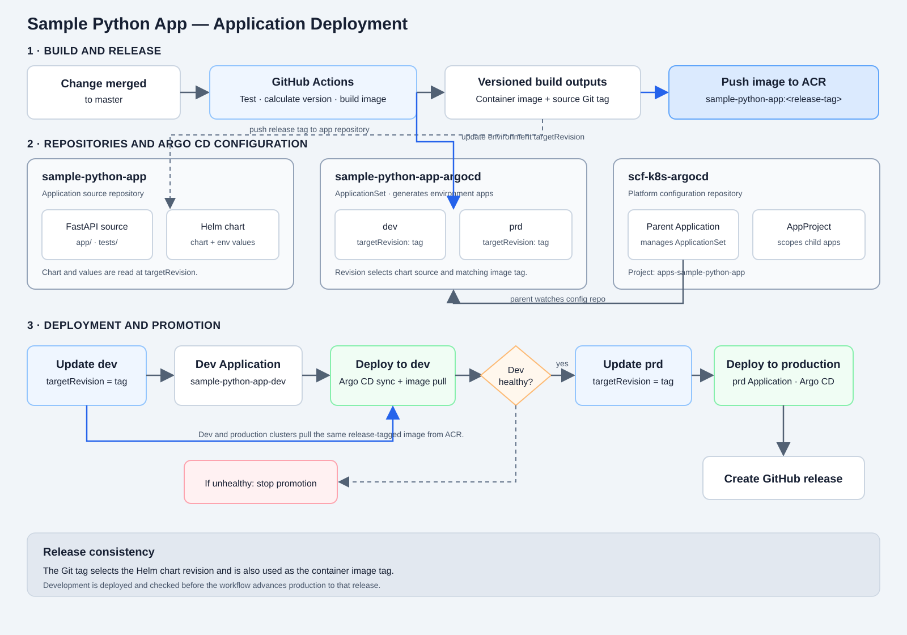

# Sample Python App for AKS

A small FastAPI application packaged as a non-root Docker image and deployed to
AKS with Helm and Argo CD. The application provides a web dashboard, a status
endpoint, and a health endpoint.

## Repository layout

- `app/` — FastAPI application and dashboard template.
- `helm/sample-python-app/` — reusable Helm chart.
- `tests/` — application tests.
- `.github/workflows/build-and-push-acr.yml` — image build, deployment, and
  release workflow.
- `pandeyaws/sample-python-app-argocd` — separate repository containing the
  Argo CD ApplicationSet.
- `pandeyaws/scf-k8s-argocd` — platform repository containing this app's Argo CD
  parent Application and AppProject.

## Run locally

The commands below use PowerShell:

```powershell
python -m venv .venv
.\.venv\Scripts\Activate.ps1
python -m pip install -r requirements.txt
python -m pip install "httpx2>=2.0.0,<3.0.0" "pytest>=8.0.0,<10.0.0" "pytest-cov>=5.0.0,<8.0.0"
uvicorn app.main:app --reload --port 8000
```

Open `http://localhost:8000/` for the dashboard. The JSON status endpoint is
`http://localhost:8000/api/status`, and the health endpoint is
`http://localhost:8000/health`.

## Run tests

With the dependencies installed, run:

```powershell
python -m pytest --junitxml=test-results.xml --cov=app --cov-fail-under=80 --cov-report=xml:coverage.xml --cov-report=term-missing
```

The command requires at least 80% application coverage. It writes JUnit results
to `test-results.xml` and coverage details to `coverage.xml`.

## Application architecture

The deployment is split across three repositories, with Argo CD managing the
transition from a built release to the workloads running in AKS:

| Repository | Responsibility |
| --- | --- |
| `pandeyaws/sample-python-app` (this repository) | FastAPI source, Helm chart and environment values; GitHub Actions tests the app, builds and publishes its container image, and starts deployments. |
| `pandeyaws/sample-python-app-argocd` | ApplicationSet that generates the `dev` and `prd` child Applications. Each environment's `targetRevision` selects the revision of this repository used for its Helm chart and image. |
| `pandeyaws/scf-k8s-argocd` | Argo CD parent Application and the `apps-sample-python-app` AppProject, which scopes the Argo CD applications and their access. |



On a push to `master`, GitHub Actions calculates a release tag, tests the
application, builds and pushes the image with that tag, and pushes the tag to
this repository. It then updates the selected environment's `targetRevision`
in the ApplicationSet. That value is a Git tag in this repository: Argo CD
uses it to load `helm/sample-python-app` and its `values.yaml` plus
environment-specific values, and the ApplicationSet uses the same value as the
container image tag. The workflow deploys `dev` first and advances `prd` only
after development succeeds.

## Build and deployment workflow

The GitHub Actions workflow is triggered by pushes and pull requests targeting
`master`. Its jobs are currently gated to pushes to `master`, so a pull-request
run does not build or deploy the application.

On a push to `master`, the workflow:

1. Calculates the next `vMAJOR.MINOR.PATCH` tag from commit messages. It
   recognizes conventional commit messages (`fix:` for patch, `feat:` for
   minor, and a `BREAKING CHANGE:` footer for major); if no bump is detected it
   defaults to patch.
2. Runs tests, builds the image, scans it for critical and high vulnerabilities,
   and pushes it to
   `acreusdev01.azurecr.io/sample-python-app` with both the version tag and
   commit SHA as image tags.
3. Pushes the version tag to this repository.
4. Updates the `dev` environment's `targetRevision` in the Argo CD
   ApplicationSet in `pandeyaws/sample-python-app-argocd`, then syncs and waits
   for the parent Argo CD application and waits for the development app to
   become healthy. The parent Application and its `apps-sample-python-app`
   AppProject are managed in `pandeyaws/scf-k8s-argocd`.
5. After development succeeds, updates the `prd` environment and performs the
   production Argo CD sync and health wait.
6. After production succeeds, creates a GitHub release for the version tag and
   generates release notes.

The workflow uses Argo CD automated sync for the generated environment
applications. GitHub immutable releases must also be enabled in repository
settings if releases are to be immutable.

## GitHub Actions and Azure configuration

The workflow uses these GitHub Actions values:

| Name | Type | Purpose |
| --- | --- | --- |
| `APP_ID` | Variable | GitHub App ID used to access this repository and the Argo CD configuration repository. |
| `APP_PRIVATE_KEY` | Secret | Private key for that GitHub App. The app needs repository Contents access to push the version tag and update the configuration repository. |
| `AZURE_CLIENT_ID` | Secret | Azure identity used by GitHub Actions OIDC login. |
| `AZURE_TENANT_ID` | Secret | Azure tenant for the identity. |
| `AZURE_SUBSCRIPTION_ID` | Secret | Azure subscription for the identity. |
| `ARGOCD_SERVER` | Secret | Argo CD API server address. |
| `ARGOCD_USERNAME` | Secret | Argo CD account used by the deployment action. |
| `ARGOCD_PASSWORD` | Secret | Password for that Argo CD account. |

The build and development deployment jobs use the GitHub Actions environment
named `development`; production deployment uses the `production` environment.
Configure environment-specific secrets there if the values differ between
environments, and ensure the required environments exist.

Configure an Azure federated credential for the repository's `development`
environment. Its subject must be
`repo:<OWNER>/<REPO>:environment:development`, its issuer
`https://token.actions.githubusercontent.com`, and its audience
`api://AzureADTokenExchange`. Grant the Azure identity the `AcrPush` role on
the `acreusdev01` registry. The AKS cluster must also be allowed to pull images
from that registry.

## Argo CD permissions

The deployment workflow authenticates with `ARGOCD_USERNAME` and
`ARGOCD_PASSWORD`. Successful login proves the account authenticated; it does
not grant permission to sync applications. A `PermissionDenied` on
`argocd app sync` means the account's effective Argo CD RBAC policy does not
allow that operation on the target application.

An Argo CD administrator should check the parent application's project:

```bash
argocd app get apps-sample-python-app -o json | jq -r '.spec.project'
```

For an Argo CD project role, grant at least `get` and `sync` on the parent
application. In the policy object, use `<application-project>/<application-name>`
and replace the placeholders with the parent's actual project and name. For
example, if its project is `apps-sample-python-app`, the object is
`apps-sample-python-app/apps-sample-python-app`:

```yaml
policies:
  - p, proj:apps-sample-python-app:apps-sample-python-app-admin, applications, get, apps-sample-python-app/apps-sample-python-app, allow
  - p, proj:apps-sample-python-app:apps-sample-python-app-admin, applications, sync, apps-sample-python-app/apps-sample-python-app, allow
```

Add policies to the existing role configuration; do not replace unrelated
policies. Ensure the identity used by the workflow is actually assigned to that
role. For an SSO-managed role, this means assigning the matching SSO group. A
local Argo CD username/password account may need an appropriate global RBAC
role instead of an SSO group mapping.

The shared deployment action also reads/waits on the environment child
application and syncs `cert-manager` and `external-secrets`. Check and grant
only the required access to those applications as well. Their Argo CD projects
may differ from the parent application's project.

Validate access while logged into the same Argo CD server as the workflow,
using the same account and credentials. These commands are read-only checks;
substitute the actual project for each application:

```bash
argocd account can-i get applications '<PROJECT>/apps-sample-python-app'
argocd account can-i sync applications '<PROJECT>/apps-sample-python-app'
argocd account can-i get applications '<PROJECT>/sample-python-app-dev'
argocd account can-i sync applications '<PROJECT>/sample-python-app-dev'
```

Run the child checks against the production application too, and check the
`cert-manager` and `external-secrets` applications if the shared action uses
them. The relevant `can-i` checks should return `yes`. If one returns `no`,
have an Argo CD administrator adjust the role or group mapping and test again.

## Render the Helm chart locally

Clone `pandeyaws/sample-python-app-argocd` alongside this repository, then run
from the application repository:

```powershell
helm template sample-python-app ./helm/sample-python-app `
    --values ../sample-python-app-argocd/argocd/values/dev.yaml `
    --namespace default
```
